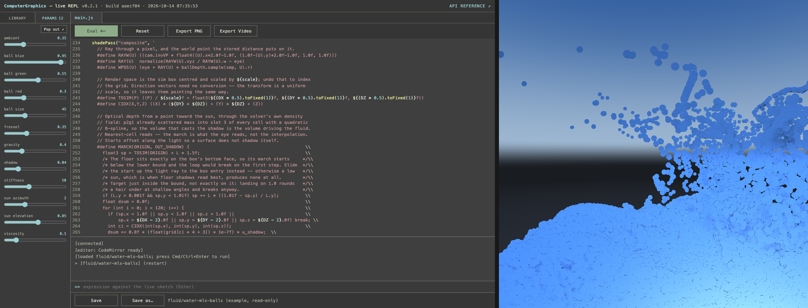
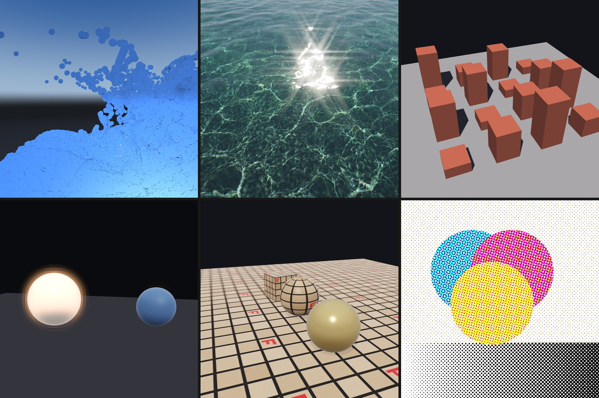
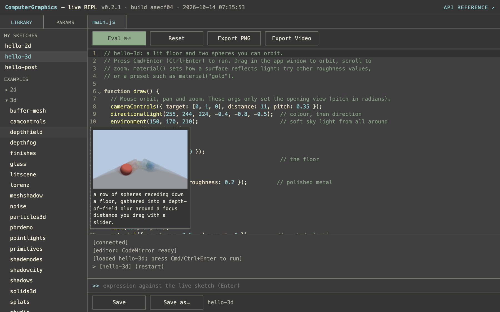
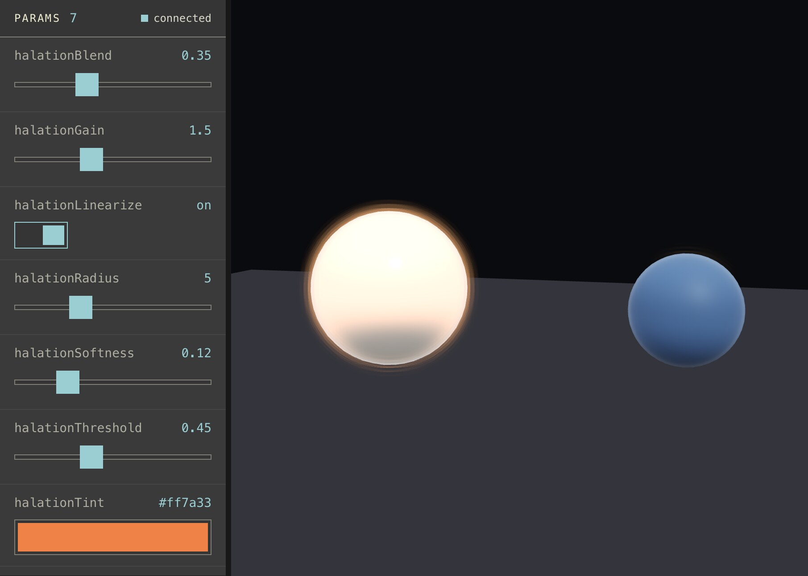
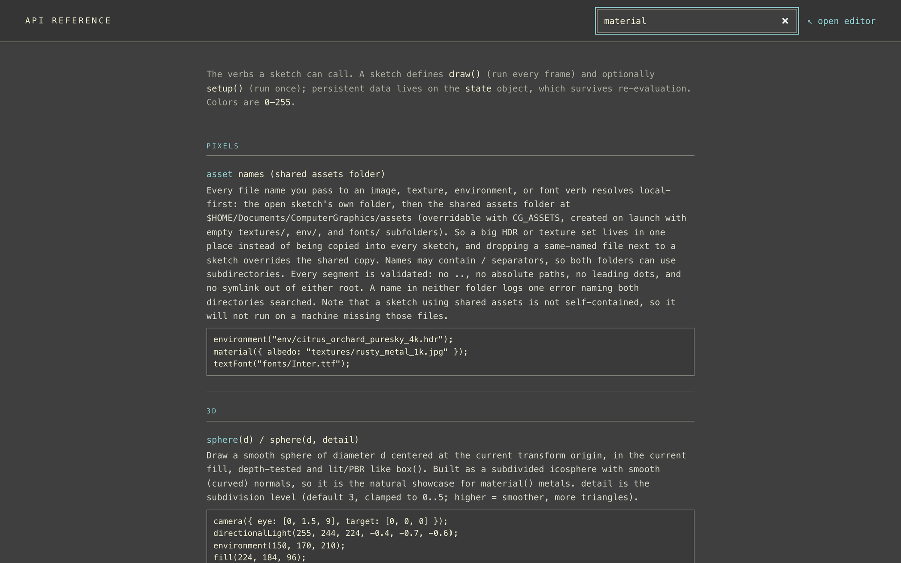

# ComputerGraphics

ComputerGraphics is a live-coding instrument for the Mac. You write small JavaScript
sketches in a browser editor, press Cmd+Enter, and a native Metal renderer draws them
in a window beside it, with no compile step. The sketch API will feel familiar if you
know Processing or p5.js (`setup()`, `draw()`, `fill()`, `circle()`), and it reaches
past them into 3D, GPU shaders and video export.

This repository holds the signed, notarized macOS downloads, and it is where to report
problems. The source code is not public.



## What you can make

The app ships with a library of examples you can open, run and copy. Among them:

- **2D drawing**: shapes, paths and crisp text at any scale, per-pixel image work
  (`loadPixels()`, `createImage()`), Perlin noise fields, and mouse and keyboard
  interaction.
- **3D scenes**: lights, soft shadows, physically based materials with texture maps,
  displacement, refractive glass, OBJ models, Gaussian splats, and an orbit camera in
  one line (`cameraControls()`).
- **Your own GPU code**: post-processing filters, compute passes and feedback trails
  written in Metal Shading Language, recompiled live as you type. The examples include
  a pixel sort, a halation glow, a CMYK halftone, a datamosh and a set of blend
  modes.
- **Simulation**: GPU particle systems, a Lorenz attractor, MLS-MPM water and sunlit
  shallow water.
- **Live controls**: `param()` puts a slider, switch or colour swatch in the editor's
  Params tab (it can pop out into its own window), and MIDI controllers, OSC senders
  and monome Grid and Arc devices can drive the same params.
- **Camera input**: `webcam()` brings the live camera in as a texture, and
  `estimateDepth()` runs a depth model over it.
- **Finished video**: `renderVideo()` renders a sketch offline, frame by frame, to an
  H.264 mp4 with optional audio, and `timeline()` / `drive()` automate params over
  time, so a music video can be a sketch plus a list of keyframes. `saveFrame()`
  writes PNG stills.



## System requirements

- macOS 13 Ventura or later.
- A Mac with Apple silicon (M1 or later). There is no Intel build.
- A current web browser for the editor, which is a page the app serves on
  `127.0.0.1`.

## Install

1. Download the `.dmg` from the
   [latest release](https://github.com/laferrera/computergraphics-releases/releases/latest).
2. Open it and drag **ComputerGraphics** into **Applications**.
3. Open ComputerGraphics from Applications.

The app and the disk image are signed with an Apple Developer ID and notarized by
Apple, so macOS opens them without a warning about an unidentified developer.

## First launch

- **Documents access.** macOS asks whether ComputerGraphics may access files in your
  Documents folder. Click **Allow**: your sketches, and the videos and stills you
  export, live in `~/Documents/ComputerGraphics/`. The prompt can appear behind other
  windows, so look for it if nothing seems to happen. If you clicked Don't Allow, turn
  it back on in System Settings > Privacy & Security > Files and Folders.
- **The editor.** A few seconds after launch the editor opens in your default browser
  at [http://127.0.0.1:6969](http://127.0.0.1:6969), and a render window opens beside
  it. If the browser does not open, visit that address yourself.
- **Starter sketches.** The first launch creates
  `~/Documents/ComputerGraphics/sketches` holding three starters, `hello-2d`,
  `hello-3d` and `hello-post`, listed under **My sketches** in the editor's Library.
  Click one, then press **Cmd+Enter** to run it.
- **Examples.** Hover an entry under **Examples** to see a picture and a one-line
  description. Examples are read-only; press **Save** on one to copy it, with its
  assets, into My sketches, where you can edit it.



Sketches are plain folders of `.js` and `.metal` files on disk, so you can also edit
them in any text editor, back them up or put them under version control.

## A first sketch

Paste this into a new sketch and press Cmd+Enter:

```js
function draw() {
  background(20);
  const n = param("count", { type: "step", min: 3, max: 24, step: 1, default: 12 });
  noStroke();
  translate(width / 2, height / 2);
  rotate(millis() / 1000);
  for (let i = 0; i < n; i++) {
    const a = (i / n) * Math.PI * 2;
    fill(255, 140 + 100 * Math.sin(a), 90);
    circle(Math.cos(a) * width * 0.3, Math.sin(a) * width * 0.3, width * 0.06);
  }
}
```

A ring of warm dots turns slowly. Open the **Params** tab and drag `count` to change
how many there are while it runs. Edit a number in the code and press Cmd+Enter again
to see the change at once. `print()` and `println()` write to the console under the
editor, and the `>>` line there evaluates an expression against the running sketch.

The Params tab's **Pop out** button opens the same controls in a window of their own,
so they can sit beside the render while the editor is elsewhere:



## Documentation

The API reference is at
[http://localhost:6969/docs.html](http://localhost:6969/docs.html). The app serves it,
so it needs ComputerGraphics to be running; it is also linked as **API reference** in
the editor's header. It lists every sketch function with its arguments, a description
and often an example, it is searchable, and it works offline. The editor completes the
same functions as you type.



The examples are the other half of the documentation: each one opens with a comment
saying what it shows.

## Updates

Once a day at most, when the editor page loads, it asks GitHub for the latest release
of this repository: one unauthenticated request to
`https://api.github.com/repos/laferrera/computergraphics-releases/releases/latest`,
made by your browser. It carries nothing about you or your sketches, only what any web
request carries (your IP address, your browser's user agent, and an `Origin` of
`http://127.0.0.1:6969`). If a newer version exists, the editor header shows
"vX.Y.Z available" with a link to the release page. Nothing is downloaded or installed
for you; to update, download the new `.dmg` and replace the app in Applications. Any
failure (offline, rate limited) shows nothing.

To turn the check off, launch the app with `CG_UPDATE_CHECK=0`:

```bash
open -n --env CG_UPDATE_CHECK=0 /Applications/ComputerGraphics.app
```

## Privacy and network

- The editor server listens on `127.0.0.1:6969` only, so other machines cannot reach
  it. Requests that run code or change files are refused unless they come from the
  app's own address, so a web page on another site cannot send code to it.
- `CG_HOST=0.0.0.0` makes the server reachable from your local network, for example
  to code from another computer. There is no authentication: anyone who can reach the
  port can run code in the app and read and overwrite your sketches. Use it only on a
  network you trust. `CG_PORT` changes the port.
- OSC input listens on `127.0.0.1:9000`, also loopback only. MIDI devices are
  connected automatically.
- The camera is opened only when a sketch calls `webcam()`, and macOS asks for
  permission the first time.
- Apart from the update check, the app makes no network requests of its own. The
  editor's code is bundled with the app, so it works with no internet connection.

## Using it with an AI agent

The app bundle includes an MCP server, so an agent such as Claude Code can launch the
app, run and edit sketches, read their errors and look at the frames they render. With
Node 22 installed and the app in Applications:

```bash
claude mcp add computergraphics -- node /Applications/ComputerGraphics.app/Contents/Resources/tools/mcp/server.mjs
```

## Uninstall

Drag ComputerGraphics from Applications to the Trash. Your sketches, exports and
assets stay in `~/Documents/ComputerGraphics/`; delete that folder too if you want
them gone.

## Reporting issues

Open an issue in this repository's
[Issues](https://github.com/laferrera/computergraphics-releases/issues). It helps to
include the version (shown in the editor header and in the app's Get Info window),
your macOS version and Mac model, what you expected and what happened, and the
sketch, or the smallest part of it, that shows the problem. Any error from the
editor console is useful too.
